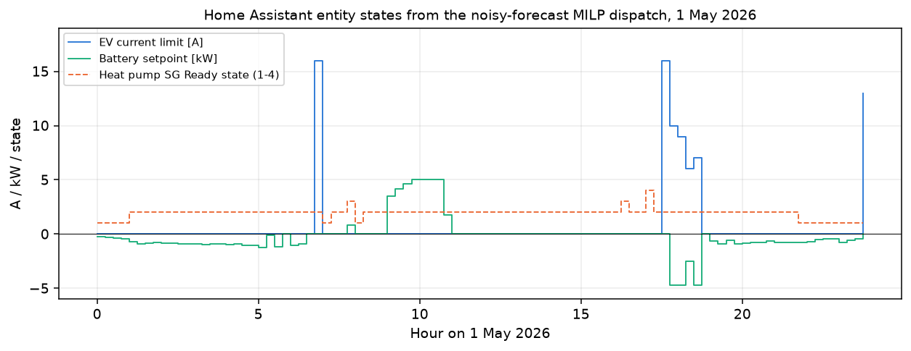

# Home and C&I energy management on 15-minute Polish prices

[](https://github.com/kwwaleszczynski-del/pl-hems-mpc/actions/workflows/ci.yml)

A Polish house with rooftop PV, a battery, a heat pump and an EV charger sits under two price signals at once: its
exports are credited to a 12-month FIFO deposit at the 15-minute market price RCE (zero when RCE is negative), and its
imports pay a flat (G11), two-zone (G12w) or dynamic day-ahead tariff plus distribution fees paid in cash. A commercial
low-voltage site on C23 faces a second rule: on each working day the capacity fee (141.20 PLN/MWh in the second half
of 2025, 219.40 PLN/MWh in 2026, charged on energy drawn 07:00-21:59) is multiplied by 0.17 when mean import in those
hours stays within 5 % of mean import in the other hours of the day (group K1 under Art. 70a of the Capacity Market
Act).

This repository simulates both cases at 15-minute resolution from 1 October 2025 to 30 September 2026 (35,040
quarter-hours, a window defined in UTC, see [Data](#data)) on real PSE prices (SDAC and RCE) and ERA5 weather, with
**synthetic** household and C&I loads. It compares rule-based controls with a mixed-integer program (MILP) solved once
per day, replays the resulting set-points over a localhost Modbus TCP emulator with a watchdog, and exports the entity
states as Home Assistant MQTT discovery payloads.

**Dashboard:** https://kwwaleszczynski-del.github.io/pl-hems-mpc/

> Loads are synthetic. Energy prices and the household distribution rates are illustrative round numbers, not a
> specific supplier's or DSO's tariff; the C23 per-MWh charges of the C&I site are those of one DSO's 2026 tariff,
> applied to the whole window. The net-billing and capacity-fee rules are simplified readings of the statutes;
> sources are listed in [Regulatory assumptions](#regulatory-assumptions-to-be-verified) and every rule must be
> verified before real use. The Modbus register map belongs to the emulator in this repository and must not be
> written to a real inverter.

## Key results

### 1. Prosumer under 12-month FIFO net-billing

10 kWp PV, 10 kWh / 5 kW LFP battery, heat pump (3.5 kW electric) with a floor-slab heat store and an 11 kW EV
charger. Over the simulated year RCE was zero or negative for 357.5 hours (1,430
quarter-hours), down to -1,457.6 PLN/MWh at 2026-05-01 14:15.

| Tariff | Strategy | Import [MWh] | Export [MWh] | Curtailed [MWh] | Export at RCE <= 0 [MWh] | Net cash bill [PLN] | Battery wear [PLN] | Total [PLN/yr] | vs uncontrolled |
|---|---|---:|---:|---:|---:|---:|---:|---:|---:|
| G11 | Uncontrolled | 8.23 | 6.66 | 0.00 | 1.69 | 6,325 | 375 | 6,700 | - |
| G11 | Negative-price guard | 8.23 | 5.03 | 1.63 | 0.00 | 6,288 | 374 | 6,662 | -38 (-0.6 %) |
| G11 | Fixed time-window rules | 8.06 | 4.81 | 1.57 | 0.00 | 6,204 | 370 | 6,574 | -126 (-1.9 %) |
| G11 | Daily MILP, noisy forecast | 7.34 | 4.86 | 1.01 | 0.00 | 5,549 | 331 | 5,880 | -820 (-12.2 %) |
| G11 | Daily MILP, perfect foresight | 7.24 | 4.85 | 0.91 | 0.00 | 5,439 | 337 | 5,777 | -923 (-13.8 %) |
| G12w | Uncontrolled | 8.23 | 6.66 | 0.00 | 1.69 | 5,181 | 375 | 5,556 | - |
| G12w | Negative-price guard | 8.23 | 5.03 | 1.63 | 0.00 | 4,096 | 374 | 4,469 | -1,086 (-19.6 %) |
| G12w | Fixed time-window rules | 8.28 | 4.88 | 1.59 | 0.00 | 3,963 | 370 | 4,333 | -1,223 (-22.0 %) |
| G12w | Daily MILP, noisy forecast | 8.35 | 5.65 | 1.12 | 0.00 | 3,160 | 423 | 3,583 | -1,973 (-35.5 %) |
| G12w | Daily MILP, perfect foresight | 8.55 | 5.97 | 0.96 | 0.00 | 3,003 | 485 | 3,488 | -2,067 (-37.2 %) |
| Dynamic SDAC + G12w | Uncontrolled | 8.23 | 6.66 | 0.00 | 1.69 | 5,978 | 375 | 6,352 | - |
| Dynamic SDAC + G12w | Negative-price guard | 8.23 | 5.03 | 1.63 | 0.00 | 4,996 | 374 | 5,370 | -983 (-15.5 %) |
| Dynamic SDAC + G12w | Fixed time-window rules | 8.23 | 4.87 | 1.60 | 0.00 | 4,610 | 395 | 5,005 | -1,347 (-21.2 %) |
| Dynamic SDAC + G12w | Daily MILP, noisy forecast | 7.67 | 5.03 | 1.04 | 0.00 | 3,547 | 427 | 3,974 | -2,378 (-37.4 %) |
| Dynamic SDAC + G12w | Daily MILP, perfect foresight | 7.60 | 5.07 | 0.91 | 0.00 | 3,428 | 452 | 3,881 | -2,472 (-38.9 %) |


- **Without control, the dynamic tariff costs 797 PLN/yr more than G12w.** The uncontrolled house exports 1.69
  MWh/yr at RCE <= 0 for zero credit; none of the controlled strategies exports at RCE <= 0 (the surplus goes to the
  battery, the heat pump, the EV or is curtailed).
- **The noisy-forecast MILP saves 2,378 PLN/yr on Dynamic SDAC + G12w (37.4 %), 1,973
  PLN/yr on G12w (35.5 %) and 820 PLN/yr on G11 (12.2 %)**, which is 96 %,
  95 % and 89 % of the perfect-foresight saving. The forecast is synthetic (independent noise on
  actual PV and load, see [Method](#prosumer-controllers)), so these shares are optimistic. The better of the two
  fixed rules saves 1,347 / 1,223 / 126 PLN/yr on the same three tariffs.
- **With the MILP, Dynamic SDAC + G12w still costs 391 PLN/yr more than G12w.** This ranking depends on the
  illustrative G12w energy prices (720 / 430 PLN/MWh) and the 85 PLN/MWh dynamic margin assumed here.


### 2. Commercial site on C23 and the capacity fee

50 kWp PV and a 100 kWh / 50 kW battery on a low-voltage connection with a synthetic load (17.5 kW at night,
34-46 kW on the day shift, independent 11 % noise per quarter-hour, at most 56 kW). The contracted power is 60 kW,
the round value above that peak, so the site falls in group C2x (low voltage, more than 40 kW); it is billed on the
three-zone C23. On each working day the capacity fee for the
energy drawn 07:00-21:59 is multiplied by $`A \in \{0.17, 0.50, 0.83, 1.00\}`$ according to the difference
$`\Delta`$ between mean import in those hours and mean import in the other hours (K1 below 5 %, K2 below 10 %, K3
below 15 %, K4 otherwise).

| Operating mode | Energy + C23 [PLN] | Capacity fee [PLN] | Mean factor A | Working days in K1 | Quarter-hours above 60 kW | Battery wear [PLN] | Net total [PLN/yr] |
|---|---:|---:|---:|---:|---:|---:|---:|
| PV only | 148,598 | 14,518 | 0.82 | 22.2 % | 0 | 0 | 162,842 |
| PV + battery, self-consumption | 145,317 | 14,496 | 0.82 | 22.6 % | 0 | 551 | 160,334 |
| PV + battery, ratio rule | 144,091 | 3,852 | 0.25 | 88.5 % | 0 | 2,680 | 150,593 |
| PV + battery, MILP perfect foresight | 129,239 | 2,649 | 0.17 | 100.0 % | 0 | 5,531 | 137,235 |


- **Self-consumption does not move the capacity fee** (14,496 vs 14,518 PLN/yr): it never charges from the grid,
  so night import stays at the base load and the peak/off-peak ratio barely changes.
- **The causal ratio rule puts 88.5 % of working days in K1** and cuts the capacity fee by 10,666 PLN/yr
  (-74 %) and the total by 12,249 PLN/yr. It has one tuning constant (the 4 % margin below
  the K1 threshold) and reads only the import already measured that day.
- **The perfect-foresight MILP is an upper bound**: every working day in K1 and 25,607 PLN/yr lower total cost than
  PV only, of which 19,359 PLN/yr is energy and distribution and 11,869 PLN/yr capacity fee, against 5,531 PLN/yr
  more battery wear. No mode exceeds the 60 kW contracted power: PV only peaks at 55.3 kW, and both battery
  strategies reach 60 kW when they charge from the grid at night.

### 3. Closed-loop Modbus TCP test and watchdog

`src/hems_mpc/modbus_hil.py` runs a Modbus TCP server and client (7-byte MBAP header + PDU for function codes `0x03`,
`0x06` and `0x10`) over `127.0.0.1` against an emulated inverter. The register map is specific to this emulator:

| Register | Type | R/W | Function | On watchdog timeout |
|---|---|:-:|---|---|
| `40001` | `uint16` | R/W | Control mode (`0` = self-consumption, `2` = forced EMS) | reverts to `0` |
| `40002` | `int16` | R/W | Battery power command [W] (`+` charge, `-` discharge) | reverts to `0` |
| `40003` | `uint16` | R/W | Grid export limit [W] (`0` when RCE <= 0) | reverts to `10000` |
| `40004` | `uint16` | R/W | Heartbeat counter incremented every 15 min | monitored by the emulator |
| `40005` | `uint16` | R/W | Watchdog timeout [s] (default `900`) | - |
| `40010`..`40016` | `uint16`/`int16` | R | SoC [0.1 %], PV [W], load [W], actual battery [W], grid [W], curtailed PV [W], watchdog flag | - |


The 7-day replay (672 quarter-hour socket transactions, Dynamic SDAC + G12w, noisy-forecast MILP) stops
writing for 3 steps from 2026-05-01 12:00. The emulator checks the heartbeat once per quarter-hour and
trips when more than 900 s have passed without a change, so the flag `40016 = 1` appears at 2026-05-01 12:15 and stays
for 2 steps. In those two steps the emulator runs self-consumption with the export limit lifted and exports 7.4-7.9 kW
at an RCE of -1,013 and -1,128 PLN/MWh (`results/modbus_hil_trace.csv`); zero-export curtailment resumes at 12:45 when
writes return. A fallback that keeps the last export limit would avoid this.

### 4. Home Assistant export

`src/hems_mpc/ha_bridge.py` writes MQTT discovery payloads for six entities (RCE price, battery set-point, export
limit, zero-export guard, SG Ready state, EV current limit) to `results/mqtt_discovery.json`, a state message per
quarter-hour derived from the dispatch to `results/ha_live_entities_24h.json`, and a `configuration.yaml` snippet for
the emulator's register map to `results/ha_config_example.yaml`. This is an export of entity definitions, not an
installable Home Assistant integration, and none of it has been tested against a running Home Assistant. The SG Ready
state compares the planned heat-pump power with the steady-state need (above: store heat, well above at full power:
forced, below: lock); the EV current limit is the planned power at three-phase 230 V, 0 A below 1.2 kW and otherwise
6-16 A.



## Method

### Data

15-minute RCE and SDAC prices for the Polish zone from the PSE reports API (`rce-pln`, `csdac-pln`) and ERA5 weather
(Open-Meteo) for one grid point in central Poland (52.75 N, 18.25 E), cached in
`data/pl_hems_inputs_2025_2026.parquet`. The PV array (35 deg tilt, south) sits at the same point. Household base load,
heating season, internal gains, EV plug-in times and trip energy, and the C&I load are synthetic shapes with seeded
noise (`physics.generate_household_profiles`, `controllers.simulate_ci_site`). Sources and terms of use are in
[Data and licenses](#data-and-licenses).

The simulated window is defined in UTC: 2025-10-01 00:00 to 2026-09-30 23:45 UTC, which is 02:00 on 1 October 2025
to 01:45 on 1 October 2026 in Polish time (CEST, UTC+2). Tariff zones, capacity-fee hours, working days, billing
months and the daily optimisation all use local time (Europe/Warsaw), so the first local day lacks its first two hours,
and the run ends with the first two night hours of 1 October 2026 (no fee hours; a two-hour 13th month in the deposit
ledger). Both clock changes fall inside the window, so it still has 35,040 quarter-hours.

### Net-billing deposit

All amounts are net of VAT. Each month $`m`$ adds the export credit

```math
D_m = \sum_{t \in m} E^{\mathrm{exp}}_t \cdot \max\bigl(0,\, p^{\mathrm{RCE}}_t\bigr)
```

to a FIFO queue; it becomes usable in the following month and stays usable for 12 months. Monthly active-energy cost
$`\sum_{t \in m} E^{\mathrm{imp}}_t p^{\mathrm{buy}}_t`$ draws on the oldest credit first; distribution charges are
paid in cash. Credit unused after 12 months is refunded up to $`0.30\, D_m`$ and the rest expires. Credit still open on
30 September 2026 is settled the same way, which is conservative because in reality it would cover later imports. The
amendment of the RES Act multiplies the deposit by 1.23, which matches the 23 % VAT on household bills; dividing both
sides by 1.23 gives the net-of-VAT form above (this reading is to be verified).

### Heat demand and slab heat store

There is no RC model of the building. Heat demand is steady-state,
$`Q_t = \max\bigl(0,\, UA\,(T_{\mathrm{set}} - T_{\mathrm{out},t}) - Q_{\mathrm{sun},t} - Q_{\mathrm{int},t}\bigr) + Q_{\mathrm{DHW}}`$
during the heating season, with $`UA = 0.165`$ kW/K, $`T_{\mathrm{set}} = 21.3`$ °C and a flat 0.12 kW of hot water.
The rule-based strategies meet $`Q_t`$ directly (the time-window rules add a simple pre-heat buffer). The MILP adds one
storage state, heat held in the floor slab relative to nominal,

```math
e_t = 0.985\, e_{t-1} + \Delta t \bigl(\mathrm{COP}(T_{\mathrm{out},t})\, P^{\mathrm{hp}}_t - Q_t\bigr),
\qquad -1.5 \le e_t \le 9.5\ \mathrm{kWh_{th}}, \quad e_{T} \ge 0,
```

with $`\Delta t = 0.25`$ h and a COP curve that falls with outdoor temperature and dips around 0 °C for defrost.

### Prosumer controllers

- **Uncontrolled**: battery charges from PV surplus and covers any deficit, the heat pump follows demand, the EV
  charges at 11 kW from 17:30 every day.
- **Negative-price guard**: as above, plus zero export at RCE <= 0; before 10:30 the battery stays below 35 % while
  RCE is above 80 PLN/MWh to leave room for midday surplus, and the EV charges only 22:00-06:00, from PV surplus or at
  RCE <= 0.
- **Fixed time-window rules**: night grid charging, pre-heating and EV charging in fixed windows with price thresholds.
- **Daily MILP** (`controllers.solve_day_milp`, `scipy.optimize.milp` with HiGHS): one problem per local calendar day
  (96 quarter-hours, 92 or 100 on clock-change days), solved at 00:00 over grid import, export, curtailment, battery
  charge and discharge, heat-pump power, EV charging and the slab store. A binary per quarter-hour forbids importing
  and exporting at the same time; export plus curtailment cannot exceed PV. Active energy and export credit are
  weighted by 0.82 (deposit money can expire), discharge carries a wear cost of 160 PLN/MWh and the end-of-day battery
  energy gets a terminal value. The EV must receive the day's trip energy.
  - *Perfect foresight* executes the plan on actual data.
  - *Noisy forecast* plans on actual PV and base load multiplied by independent $`\mathcal{N}(1, 0.12)`$ and
    $`\mathcal{N}(1, 0.14)`$ factors per quarter-hour and on $`0.92 \cdot p^{\mathrm{SDAC}} + \mathcal{N}(0, 22)`$ as
    the RCE forecast. Import prices, heat demand, COP and the EV schedule and energy are treated as known. A rule layer
    then follows the planned battery power within actual limits, absorbs surplus and curtails when actual RCE <= 0.
    Independent noise largely averages out within a day, so this is an optimistic stand-in for a real forecast.

### C&I controllers

- **Ratio rule** (causal, working days): charge from the grid 00:00-06:59 as fast as the 60 kW contracted power
  allows; in 07:00-21:59 discharge so import stays at or below $`\min(60,\ 1.04\,\bar P_{00-07})`$, where
  $`\bar P_{00-07}`$ is the mean import measured that morning; in 22:00-23:59 charge so import reaches
  $`\bar P_{00-07}`$. Free days run self-consumption.
- **MILP, perfect foresight** (`controllers.solve_ci_day_milp`): one problem per day over import, export, charge,
  discharge (with a binary that forbids both at once), curtailment and SoC. On a working day four binaries $`z_k`$
  choose the group and the peak energy is split into $`E_k \le M z_k`$; for $`k = 1, 2, 3`$

```math
\frac{1}{N_{\mathrm{pk}}}\sum_{t \in \mathrm{pk}} P^{\mathrm{imp}}_t
  - (1 + \delta_k)\,\frac{1}{N_{\mathrm{off}}}\sum_{t \notin \mathrm{pk}} P^{\mathrm{imp}}_t \le M\,(1 - z_k),
\qquad \delta_k \in \{0.05,\ 0.10,\ 0.15\},
```

  and the cost includes $`\sum_k A_k\, s\, E_k`$ with the day's fee rate $`s`$. Import above 60 kW is allowed only
  up to the site load and carries a control weight of 10 PLN/kWh (not a tariff charge). The battery must end the day
  with at least the energy it started with. Wear is 150 PLN/MWh discharged in all modes.

The reported cost is energy + C23 variable distribution charges + capacity fee + wear - export revenue (at RCE,
floored at zero). Contracted-power exceedance charges are not priced; the table reports the number of quarter-hours
above 60 kW instead.

## Regulatory assumptions (to be verified)

The legal state changes often; each item below is this repository's reading, checked on 30 October 2026, and none is
legal advice.

- **Capacity fee rate**: 0.1412 PLN/kWh from 1 July to 31 December 2025 (URE Informacja nr 26/2025 of 30 May 2025)
  and 0.2194 PLN/kWh for 2026 (URE Informacja nr 58/2025 of 30 October 2025), net, for consumers settled per energy
  (art. 89a ust. 1 pkt 2 of the Capacity Market Act). Until the end of 2027 households and other low-voltage sites
  with at most 16 kW contracted power pay a monthly flat rate instead (art. 89a ust. 1 pkt 1 and ust. 2), so the
  60 kW low-voltage site is settled per energy, with the K-groups.
- **Fee hours**: 15 hours from 07:00 to 21:59 on working days (Monday to Friday except public holidays) in every
  quarter of 2025 and 2026 (URE Informacja nr 55/2024 and nr 57/2025).
- **K-groups**: Art. 70a ust. 1-5 of the Capacity Market Act (consolidated text Dz. U. 2023 poz. 2131, as amended):
  one-day qualification period, difference of mean consumption in the fee hours over the other hours of working days,
  groups K1-K4 at 5 / 10 / 15 % with coefficients 0.17 / 0.50 / 0.83 / 1, K4 also when off-hour consumption is zero.
- **Net-billing**: negative RCE counts as zero for an individual prosumer (art. 4b ust. 2 pkt 2), the deposit is usable
  for 12 months from assignment and used oldest first (art. 4c ust. 5-7), refunds are capped (art. 4 ust. 11) of the
  RES Act (consolidated text Dz. U. 2024 poz. 1361). The 30 % cap for RCE-settled prosumers and the 1.23 deposit
  coefficient come from the amendment Dz. U. 2024 poz. 1847 as described in the Ministry of Climate's answer to
  interpellation 10848 (23 July 2025); whether the cap applies to the credit with or without the 1.23 coefficient
  was not verified.
- **Tariff group and C23 charges** (checked on 31 October 2026): in the
  [TAURON Dystrybucja S.A. tariff for 2026](https://www.tauron-dystrybucja.pl/-/media/offer-documents/dystrybucja/aktualna-taryfa/taryfa-tauron-dystrybucja-2026_ocr.ashx),
  approved by URE decision DRE.WRE.4211.54.8.2025.ASa1 of 17 December 2025, groups B2x are supplied at medium
  voltage and C2x at low voltage, both with more than 40 kW contracted power (B11 and C1x up to 40 kW). The site's
  per-MWh charges are the variable network rate of C23 (table 7.1: 0.2498 / 0.3613 / 0.1780 PLN/kWh in the morning
  peak, evening peak and other hours), the low-voltage quality rate (0.0332 PLN/kWh from 1 February 2026 after the
  PSE tariff change DRE.WPR.4211.1.4.2026.BTS; 0.0331 PLN/kWh in January), the OZE fee (7.30 PLN/MWh, URE
  Informacja nr 61/2025) and the cogeneration fee (3.00 PLN/MWh, Dz. U. 2025 poz. 1759), in total 293.30 / 404.80 /
  221.50 PLN/MWh net. The zones are the tariff's: morning peak 07:00-12:59, evening peak 16:00-20:59
  (October-March) or 19:00-21:59 (April-September), all other hours, weekends and public holidays in the third zone.
  The 2026 rates are applied to the whole window, although October-December 2025 fell under the 2025 tariff. Other
  DSOs' groups and rates differ.
- **Not modelled**: contracted-power exceedance charges and fixed charges (the C23 fixed network rate of
  17.52 PLN/kW/month for the 60 kW contracted power, the subscription fee), which are the same in every operating
  mode, the 15-minute versus hourly balancing of a household meter, VAT on the C&I side, and capacity-market
  obligations.

## Reproduce

Python 3.11 or newer.

```bash
python -m venv .venv
.venv/Scripts/python -m pip install -e ".[dev]"      # Linux/macOS: .venv/bin/python
.venv/Scripts/python -m pytest -q
.venv/Scripts/python -m hems_mpc
```

`python -m hems_mpc` (about 6 minutes) writes the summary tables and Home Assistant artefacts to `results/`,
the README charts to `docs/img/` and the dashboard data to `docs/data.js`. Every number quoted in this README is in
`results/summary.json` (`headline`) or follows from the CSV files in `results/`.

## Limitations

- One synthetic household and one synthetic C&I load; real savings depend on roof orientation, occupancy, heat-pump
  sizing and EV driving.
- The forecast in the noisy-forecast MILP is synthetic and optimistic; there is no PV, load or price forecasting model.
- Each day is optimised on its own (00:00 to 24:00) with a heuristic terminal value (house) or an energy-neutral end
  (C&I); there is no intraday re-planning and no look-ahead beyond midnight.
- The daily MILP sees the day's EV trip energy at 00:00, before the car arrives at 17:30.
- The deposit ledger starts empty on 1 October 2025 and runs for one billing year.
- Household energy and distribution rates are illustrative; the C23 charges are one DSO's 2026 rates applied to the
  whole window; the capacity-fee and net-billing rules are simplified (see above).

## Layout

```
data/          cached 15-minute PSE prices (SDAC, RCE) and ERA5 weather
docs/          dashboard (index.html, data.js) and README figures (docs/img/)
results/       CSV/JSON summaries, Home Assistant export (MQTT discovery, state messages, YAML for the emulator)
src/hems_mpc/  tariffs, physics, controllers, modbus_hil, ha_bridge, pipeline, cli
tests/         property tests for tariffs, controllers, the Modbus TCP loop and output consistency
```

## Data and licenses

Code: MIT (see `LICENSE`). The input file `data/pl_hems_inputs_2025_2026.parquet` contains third-party data that keep
their sources' terms below; the MIT license does not cover them. Results in `results/` and `docs/` are derived from
these data and carry the same attributions.

- **Prices**: 15-minute RCE (*rynkowa cena energii*) and SDAC prices for the Polish zone, PSE S.A. reports API
  ([raporty.pse.pl](https://raporty.pse.pl), reports `rce-pln` and `csdac-pln`), downloaded on 21 October 2026.
  **Terms of use.** PSE publishes conditions for re-using public sector information
  ([www.pse.pl, BIP, "Ponowne wykorzystywanie informacji sektora publicznego"](https://www.pse.pl/bip/ponowne-wykorzystanie-informacji-publicznej),
  checked on 31 October 2026). They allow commercial and non-commercial re-use of information published on
  www.pse.pl free of charge, on condition that the user names the source and the date the information was obtained,
  removes the PSE logo, and, when the information has been processed, tells recipients that it was changed and how,
  without misleading them. PSE accepts no liability for processed information and notes that some materials may be
  protected by copyright or database rights. These conditions are written for www.pse.pl; this project applies them
  to the reports API of the same operator. Attribution as required:

  > Information obtained from www.pse.pl (PSE S.A. reports `rce-pln`, `csdac-pln`), state as of 21 October 2026.
  > The information has been processed: cut to 1 October 2025 - 30 September 2026 (UTC), stored as 32-bit floats,
  > combined with weather data in one file and used in models. It is not an official PSE publication.

- **Weather**: ERA5 hourly reanalysis (Hersbach et al., 2020, [doi:10.1002/qj.3803](https://doi.org/10.1002/qj.3803);
  Copernicus Climate Change Service, ECMWF) for 52.75 N, 18.25 E via the
  [Open-Meteo Historical Weather API](https://open-meteo.com/en/docs/historical-weather-api), downloaded on
  21 October 2026, licensed **CC BY 4.0**; interpolated from hourly to 15-minute values. Contains modified Copernicus
  Climate Change Service information; neither the European Commission nor ECMWF is responsible for any use of it.
- **C23 tariff**: rates quoted from the public TAURON Dystrybucja S.A. tariff for 2026 (see
  [Regulatory assumptions](#regulatory-assumptions-to-be-verified)); the tariff document is not part of this
  repository.
