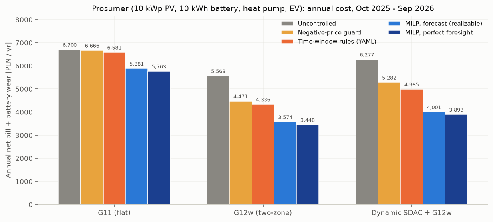
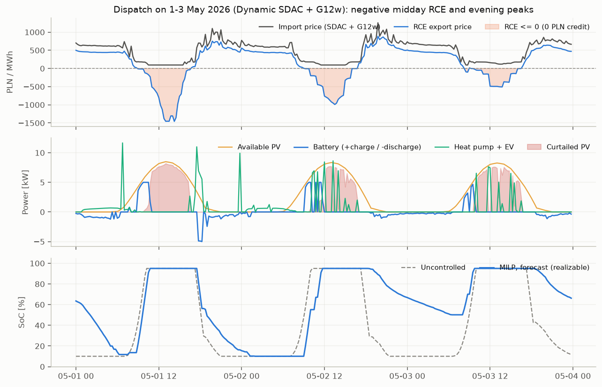
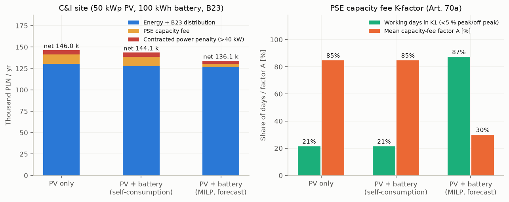
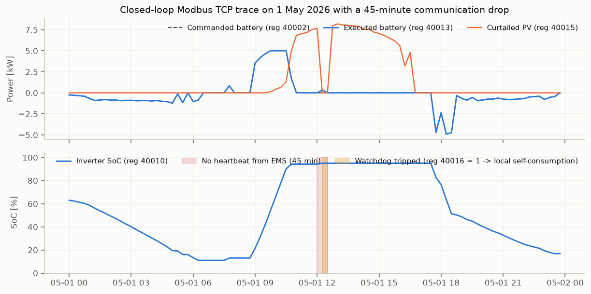
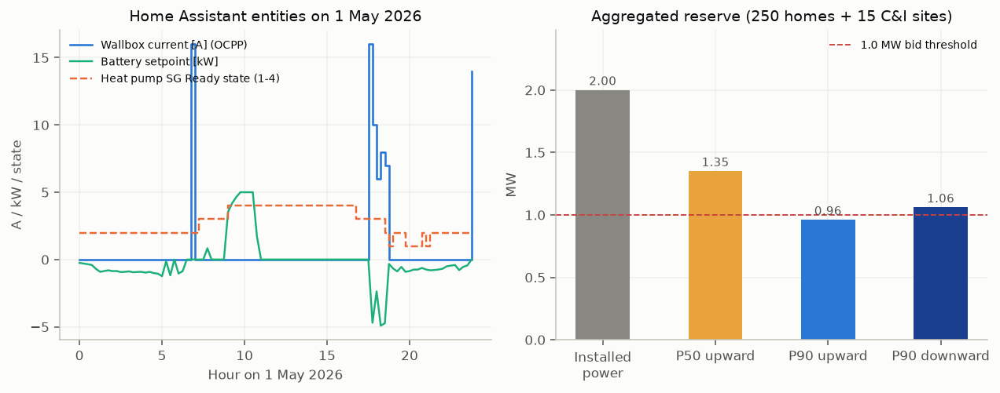

# pl-hems-mpc

[](https://github.com/kwwaleszczynski-del/pl-hems-mpc/actions/workflows/ci.yml)

A Polish house with rooftop PV, a battery, a heat pump and an EV charger sits under two price signals at once: its
exports are credited to a 12-month FIFO deposit at the 15-minute market price RCE (floored at zero when RCE is
negative), and its imports pay a flat (G11), two-zone (G12w) or dynamic day-ahead tariff plus distribution fees paid in
cash. A commercial site on B23 faces a second rule: under Art. 70a of the Capacity Market Act, the PSE capacity fee
(141.20 PLN/MWh in peak hours on working days) is cut by 83 % when peak import stays within 5 % of off-peak import
(band K1).

This repository models both cases at 15-minute resolution over the first full year of 15-minute SDAC and RCE prices in
Poland (1 October 2025 to 30 September 2026, 35,040 quarter-hours), compares simple rule-based controls with a rolling
mixed-integer program (MILP), checks the resulting set-points over a localhost Modbus TCP socket with a 15-minute
watchdog, and packages the entities and inverter register maps for Home Assistant.

**Dashboard:** https://kwwaleszczynski-del.github.io/pl-hems-mpc/

> Tariff rates, network charges and inverter register tables in this repository are illustrative configurations built
> from public tariff sheets and manuals, not billing advice or certified wiring instructions. Check every register
> address and firmware version against the manufacturer's manual before writing to a live inverter.

## Key results

### 1. Prosumer under 12-month FIFO net-billing

10 kWp PV, 10 kWh / 5 kW LFP battery, floor-slab heat pump (2R2C thermal model) and 11 kW EV charger, 1 October 2025 to
30 September 2026. Over that year RCE was zero or negative for 357.5 hours (1,430 quarter-hours, down to -1,458 PLN/MWh
on 1 May 2026).

| Tariff | Strategy | Import [MWh] | Export [MWh] | Curtailed [MWh] | Export at RCE ≤ 0 [MWh] | Net cash bill [PLN] | Battery wear [PLN] | Total [PLN/yr] | vs uncontrolled |
|---|---|---:|---:|---:|---:|---:|---:|---:|---:|
| G11 | Uncontrolled | 8.28 | 6.59 | 0.00 | 1.67 | 6,326 | 373 | 6,700 | - |
| G11 | Negative-price guard | 8.28 | 4.99 | 1.61 | 0.00 | 6,293 | 373 | 6,666 | -34 (-0.5 %) |
| G11 | YAML time rules | 8.11 | 4.76 | 1.56 | 0.00 | 6,212 | 369 | 6,581 | -119 (-1.8 %) |
| G11 | MILP, forecast (realizable) | 7.37 | 4.80 | 0.99 | 0.00 | 5,551 | 330 | 5,881 | -819 (-12.2 %) |
| G11 | MILP, perfect foresight | 7.31 | 4.82 | 0.90 | 0.00 | 5,429 | 334 | 5,763 | -937 (-14.0 %) |
| G12w | Uncontrolled | 8.28 | 6.59 | 0.00 | 1.67 | 5,189 | 373 | 5,563 | - |
| G12w | Negative-price guard | 8.28 | 4.99 | 1.61 | 0.00 | 4,098 | 373 | 4,471 | -1,092 (-19.6 %) |
| G12w | YAML time rules | 8.33 | 4.83 | 1.58 | 0.00 | 3,967 | 369 | 4,336 | -1,227 (-22.0 %) |
| G12w | MILP, forecast (realizable) | 8.38 | 5.58 | 1.11 | 0.00 | 3,150 | 425 | 3,574 | -1,988 (-35.7 %) |
| G12w | MILP, perfect foresight | 8.78 | 6.08 | 0.97 | 0.00 | 2,970 | 478 | 3,448 | -2,115 (-38.0 %) |
| Dynamic SDAC + G12w | Uncontrolled | 8.28 | 6.59 | 0.00 | 1.67 | 5,904 | 373 | 6,277 | - |
| Dynamic SDAC + G12w | Negative-price guard | 8.28 | 4.99 | 1.61 | 0.00 | 4,909 | 373 | 5,282 | -995 (-15.9 %) |
| Dynamic SDAC + G12w | YAML time rules | 8.28 | 4.82 | 1.59 | 0.00 | 4,591 | 394 | 4,985 | -1,292 (-20.6 %) |
| Dynamic SDAC + G12w | MILP, forecast (realizable) | 7.72 | 4.97 | 1.02 | 0.00 | 3,573 | 427 | 4,001 | -2,277 (-36.3 %) |
| Dynamic SDAC + G12w | MILP, perfect foresight | 7.65 | 5.01 | 0.90 | 0.00 | 3,440 | 453 | 3,893 | -2,384 (-38.0 %) |



- **A dynamic tariff without control costs more than G12w.** Moving an uncontrolled house from G12w (5,563 PLN/yr) to a
  dynamic SDAC contract (6,277 PLN/yr) adds 714 PLN/yr: the EV plugs in at 17:30 into the evening price peak while the
  battery is already full by 09:30 on sunny days, leaving 1.67 MWh/yr of midday PV exported at RCE ≤ 0 for zero credit.
- **The realizable MILP saves 1,988 PLN/yr on G12w and 2,277 PLN/yr on Dynamic SDAC + G12w** (-36 %), and captures
  95 % of the perfect-foresight bound despite 12 % PV and 14 % load forecast error. Fixed YAML time windows get about
  halfway (-1,227 and -1,292 PLN/yr) because they cannot tell a cloudy day from a negative-price day.
- **G12w beats Dynamic SDAC + G12w by 427 PLN/yr even with the MILP.** Under Polish net-billing a G12w prosumer still
  earns dynamic 15-minute RCE credits on exports while its winter imports stay capped at the two-zone tariff instead of
  day-ahead spikes.



### 2. Commercial site on B23 and the PSE capacity fee

50 kWp PV and 100 kWh / 50 kW battery on B23 with a 40 kW contracted power limit. On working days the PSE capacity fee
(141.20 PLN/MWh across 07:00-21:59) is multiplied by $A \in \{0.17, 0.50, 0.83, 1.00\}$ depending on the ratio
$\Delta_S$ of mean peak import to mean off-peak import (bands K1 to K4, thresholds 5 %, 10 % and 15 %).

| Operating mode | Energy + B23 [PLN] | Capacity fee [PLN] | Mean factor A | Working days in K1 | >40 kW penalty [PLN] | Battery wear [PLN] | Net total [PLN/yr] |
|---|---:|---:|---:|---:|---:|---:|---:|
| PV only (no battery) | 130,394 | 10,820 | 0.85 | 21.4 % | 5,099 | 0 | 146,046 |
| PV + 100 kWh battery (self-consumption) | 127,675 | 10,819 | 0.85 | 21.4 % | 5,099 | 545 | 144,111 |
| PV + 100 kWh battery (MILP, forecast) | 127,086 | 3,127 | 0.30 | 87.3 % | 3,697 | 2,459 | 136,105 |



- **Greedy self-consumption does not move the capacity fee** (10,819 vs 10,820 PLN/yr): the battery empties in the early
  afternoon and leaves the late-afternoon working hours unbuffered.
- **Shaping the peak/off-peak import ratio puts 87 % of working days into K1** ($A = 0.17$), cutting the capacity fee by
  7,693 PLN/yr (-71 %) and total net site cost by 9,941 PLN/yr.

### 3. Closed-loop Modbus TCP test and hardware watchdog

`src/hems_mpc/modbus_hil.py` runs a binary Modbus TCP server and client (7-byte MBAP header + PDU for function codes
`0x03`, `0x06` and `0x10`) over `127.0.0.1` against a virtual inverter:

| Register | Type | R/W | Function | On watchdog timeout |
|---|---|:-:|---|---|
| `40001` | `uint16` | R/W | Control mode (`0` = self-consumption, `2` = forced EMS) | reverts to `0` |
| `40002` | `int16` | R/W | Battery power command [W] (`+` charge, `-` discharge) | reverts to `0` |
| `40003` | `uint16` | R/W | Grid export limit [W] (`0` when RCE ≤ 0) | reverts to `10000` |
| `40004` | `uint16` | R/W | Heartbeat counter incremented every 15 min | monitored by inverter |
| `40005` | `uint16` | R/W | Watchdog timeout [s] (default `900`) | - |
| `40010`..`40016` | `uint16`/`int16` | R | SoC [0.1 %], PV [W], load [W], actual battery [W], grid [W], curtailed PV [W], watchdog flag | - |



In the 7-day test (672 quarter-hour socket transactions) the EMS stops writing between 12:00 and 12:45 on 1 May 2026:
after 900 s without a heartbeat increment on `40004` the inverter sets `40016 = 1` and reverts to local
self-consumption (`40001 = 0`), then resumes zero-export curtailment at 12:45 when writes return.

### 4. Home Assistant integration, inverter registers and fleet reserve

- **Home Assistant component** (`custom_components/pl_hems_mpc/` and `hacs.json`): exposes eight sensors and binary
  sensors for RCE, import price, the 12-month FIFO deposit, the live C&I K-band, the battery set-point, the zero-export
  relay, the heat-pump `SG Ready` state (`1:0` lock, `0:0` normal, `0:1` boost, `1:1` forced max) and the wallbox pilot
  current (`0` or `6..16 A` for OCPP 1.6J).
- **Inverter register profiles** (`src/hems_mpc/hardware_profiles.py`): holding register maps and Home Assistant YAML
  templates for Deye `SUN-8/10/12K-SG04LP3-EU`, Huawei `SUN2000 + LUNA2000`, Sungrow `SH10RT + SBR096` and Victron
  `MultiPlus-II + Cerbo GX`.
- **Aggregated reserve** (`src/hems_mpc/vpp_fleet.py`): pooling 250 households (10 kWh / 5 kW each) and 15 C&I sites
  (100 kWh / 50 kW each, 2.0 MW installed in total) yields an empirical P90 firm reserve of 1.18 MW upward and 1.29 MW
  downward across the year, clearing a 1.0 MW minimum bid threshold.



## Method

### Net-billing FIFO ledger

Each month $m$ adds export credit

```math
D_m = \sum_{t \in m} E^{\mathrm{exp}}_t \cdot \max\bigl(0,\, p^{\mathrm{RCE}}_t\bigr)
```

to a 12-month queue. Monthly active-energy import cost $\sum_{t \in m} E^{\mathrm{imp}}_t p^{\mathrm{buy}}_t$ draws from
the oldest positive bucket first; distribution charges are paid in cash. Any credit still unused 12 months after it was
earned is settled at $\min(\text{unused},\, 0.20\, D_m)$, and the remaining 80 % expires.

### Thermal and battery model

The building and floor slab follow a 2-node RC balance updated every $\Delta t = 0.25\text{ h}$:

```math
C_{\mathrm{in}} \frac{dT_{\mathrm{in}}}{dt} = \frac{T_{\mathrm{slab}} - T_{\mathrm{in}}}{R_{\mathrm{is}}}
  + \frac{T_{\mathrm{out}} - T_{\mathrm{in}}}{R_{\mathrm{io}}} + Q_{\mathrm{int}}, \qquad
C_{\mathrm{slab}} \frac{dT_{\mathrm{slab}}}{dt} = \mathrm{COP}(T_{\mathrm{out}})\, P_{\mathrm{hp}}
  - \frac{T_{\mathrm{slab}} - T_{\mathrm{in}}}{R_{\mathrm{is}}}.
```

At each 15-minute step the controller solves a 24-hour linear/mixed-integer program (`scipy.optimize.milp` / HiGHS) over
grid import, grid export, PV curtailment, battery charge/discharge, heat-pump power and EV charging, with a cycle-wear
cost on battery throughput and a peak-to-off-peak penalty for the C&I capacity-fee band.

## Reproduce

Python 3.11 or newer.

```bash
python -m venv .venv
.venv/Scripts/python -m pip install -e ".[dev]"      # Linux/macOS: .venv/bin/python
.venv/Scripts/python -m pytest -q
.venv/Scripts/python -m hems_mpc
```

`python -m hems_mpc` writes the summary tables and Home Assistant artefacts to `results/`, the README charts to
`docs/img/` and the dashboard data to `docs/data.js`.

## Limitations

- Single household and single C&I load profile; real savings depend on roof orientation, occupancy, heat-pump sizing and
  EV driving hours.
- The 12-month FIFO ledger starts with zero initial deposit on 1 October 2025 and runs for one billing year.
- The C&I capacity-fee model uses the statutory K1-K4 thresholds and 2026 rate on a single meter; it does not model
  DSO-specific reactive power penalties or multi-year capacity market obligations.
- The fleet calculation pools uncorrelated forecast errors on a single bus without low-voltage feeder voltage or
  transformer thermal constraints.

## Layout

```
custom_components/pl_hems_mpc/   Home Assistant custom component (manifest, entities)
data/                            cached 15-minute PSE prices (SDAC, RCE) and ERA5 weather
docs/                            dashboard (index.html, data.js) and README figures (docs/img/)
results/                         CSV/JSON summaries, generated Home Assistant YAML and MQTT payloads
src/hems_mpc/                    tariffs, physics, controllers, modbus_hil, hardware_profiles, ha_bridge, vpp_fleet
tests/                           unit and closed-loop Modbus TCP tests
```
